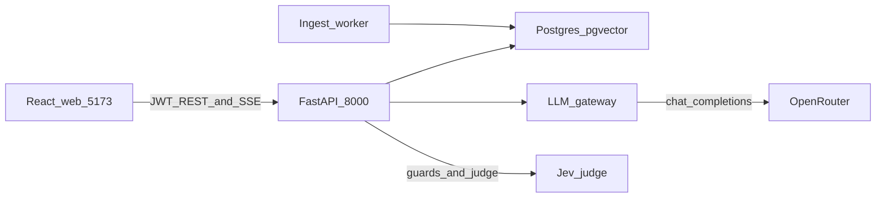

# CurioEd

A school platform for three jobs that usually live in different tools: **one shared curriculum**,
**a private record of each student's learning**, and **an explainable early-warning list a teacher
can read**.

- **Administrators** publish a shared **SourceCurriculum** and manage knowledge documents.
- **Students** study that curriculum through a private **StudentLearningDirectory**, sit the common
  quiz, and see their own result and feedback.
- **Teachers** see evidence for the classes they teach: rosters, mastery, an at-risk list where every
  flag carries its reasons, and a natural-language "ask the data" assistant.

See the [documentation hub](docs/README.md) for vision, reading paths, and the full status matrix.

```text
SourceCurriculum (shared, admin-owned)
└── AcademicPeriod → Grade → Subject → Topic → Subtopic
    ├── published lesson materials
    └── common mastery quiz

StudentLearningDirectory (private, per student)
└── same tree, with progress + quiz attempts
    (references published sources; no duplicated files)
```

All demo data comes from a **generated, synthetic school** (Al Noor). No real pupil records are used,
and nothing in this repository is a prediction about a real child.

## What it does

### Student

- Enroll in a grade and subject, then study through the learning directory: subject → topic → lesson
  (slides) → common mastery quiz → score.
- Pass mark is 70%. Student APIs never return answer keys, and copy/paste is disabled on a question
  while an attempt is in progress.
- Personal feedback after a quiz, by subject and topic, with achievement titles and a "focus on
  these first" list of weak subtopics. Students can set a goal per topic.
- Installable as a PWA (service worker and install prompt).

### Teacher

- **Classes, rosters and student pages** built on one scoped read path (`student_360`): mastery,
  quizzes taken and attendance.
- **At-risk early warning** (`/teacher/at-risk`): rule-based, not machine-learned. Mastery and
  attendance are judged separately, each flag names its drivers, a flag with no driver cannot exist,
  and every view and dismissal is audited.
- **Ask the data** (`/teacher/assistant`): a text-to-SQL assistant that answers questions about the
  teacher's own classes. Guards screen the question, the generated SQL is validated and row-scoped to
  the asking teacher, and it runs on a read-only database role. With the lean pipeline enabled, the page shows a
  live stage stepper (checking → understanding → writing a query → checking the query → looking up the
  data → writing the answer) over server-sent events.
- **Question bank and authoring** (`/teacher/questions`): generate draft questions, review them, and
  publish. Nothing is published without a person doing it.
- **Topic generation runs** (`/teacher/topics/:id/generation`): topic-grain content generation with
  streamed progress.

### Administrator

- Dashboard, curriculum browser and curriculum PDF upload with ingest status.
- Knowledge-document upload and indexing (Docling chunking, pgvector embeddings).
- Policy assistant: multi-chat, retrieval over the indexed documents, streamed answers.
- Institution-wide at-risk view and an audit-event log (API: `GET /api/v1/admin/audit-events`; no admin page).

## Status

| Area | Status |
| --- | --- |
| JWT auth, roles (`administrator`, `teacher`, `student`), enrollment gate | **Built** |
| Curriculum seed from `docs/curriculum/` and student learning directory | **Built** |
| Student study, quiz, scoring, feedback | **Built** |
| Admin materials, PDF ingest, knowledge documents, policy assistant | **Built** |
| Teacher workspace: classes, roster, student, analytics, question bank | **Built** (live API) |
| At-risk early warning (rules, audit, teacher and admin pages) | **Built** |
| Teacher text-to-SQL assistant | **Built**. Streaming needs `TEXT_TO_SQL_PIPELINE=lean` (default is `legacy`) |
| Central LLM gateway (retries, fallback models, circuit breaker, usage rows) | **Built**, enabled per feature by flag |
| Jev lesson and item judge | **Built**. Default `shadow` mode records scores and leaves the gate unchanged; `enforce` is opt-in |
| Postgres + pgvector, Postgres ingest worker | **Built** |
| Production deploy (Oracle ARM VM, Cloudflare Tunnel, k3s chart) | **Built** ([deploy/README.md](deploy/README.md), [chart](deploy/helm/curioed/README.md)) |
| Four-pillar analytics snapshots, MinIO, React Native client, student grounded assistant | **Deferred** |

Full matrix: [docs/README.md#implementation-status](docs/README.md#implementation-status).

## Design commitments

- **Rule-based early warning, not a model.** The sponsor could not supply historical outcomes, so the
  flag is a readable rule: mastery below 60, a mastery decline of more than 15 points, or attendance
  below 80. Cut-offs were calibrated on the generated school and **must be re-checked against any real
  school's own distribution**. Method and worked case:
  [docs/design/08-at-risk-early-warning.md](docs/design/08-at-risk-early-warning.md).
- **A person always decides.** A flag is a dismissible suggestion for staff, never shown to the
  student as a label, and never an automated action.
- **Access follows enrollment and assignment.** Teachers see classes they are assigned to; a second
  institution sees nothing of the first.
- **AI stays inside approved material** and behind a guard, with a human in the loop for authoring.
  When the guard service is not configured, the data-assistant guard is fail-open; a live error fails closed.

## Architecture



| Module | Role |
| --- | --- |
| `auth` | JWT access/refresh, roles, demo accounts |
| `authorization` | One place that answers "what may this person see?" (`Scope`) |
| `academics` | Periods, grades, subjects, enrollments, learning directory, demo bootstrap/reset |
| `materials` | Curriculum seed, lessons, progress, PDF ingest hooks |
| `assessments` | Quizzes and scored attempts (no answer keys on student APIs) |
| `engagement` | Active seconds on a lesson slide, and the engagement rate shown on feedback |
| `self_evaluation` | A student's confidence rating for a subject |
| `insights` | Scoped reads over the `student_360` register (dashboard, roster, student) |
| `at_risk`, `attendance` | Early-warning engine (pure function over `student_360`), flags, dismissals |
| `text_to_sql` | Teacher ask-the-data: legacy LangGraph pipeline and lean pipeline with SSE stream |
| `guard`, `judge` | Injection and off-topic classification; Jev lesson and item judge |
| `authoring`, `generation` | Draft-question authoring; topic-grain and ADK curriculum generation |
| `rag`, `assistant` | Knowledge documents, chunking, pgvector; admin policy chats |
| `progress` | Shared job-progress SSE envelope with reconnect |
| `audit` | Audit trail of every access to student data, including refused ones |
| `synthetic` | Generated school used for all demo data |
| `ai_platform/gateway` | One OpenRouter client: retries, fallback models, usage metering |
| `workers` | Postgres claim worker for PDF ingest |

## Start locally

**Prerequisites:** `uv`, Docker (Compose), Node 18+.

```bash
# macOS/Linux
./scripts/setup-macos.sh

# Windows PowerShell
./scripts/setup-windows.ps1
```

```bash
# 1. Postgres + pgvector
docker compose up -d postgres
# wait until healthy, then:

# 2. Migrate, then load docs/curriculum (the API does not seed on startup)
cd backend
uv run alembic upgrade head
uv run python -m education_platform.modules.materials.seed

# 3. API
uv run uvicorn education_platform.main:app --reload --host 127.0.0.1 --port 8000

# 4. Frontend (separate terminal)
cd frontend
cp .env.example .env   # VITE_API_BASE_URL=http://127.0.0.1:8000
npm install
npm run dev
```

Optional settings in `backend/.env`:

- `OPENROUTER_API_KEY` for live LLM stages (policy assistant, text-to-SQL, generation). Heuristic and
  stub paths still run without it.
- `TEXT_TO_SQL_PIPELINE=lean` to stream the teacher assistant's progress. With the default `legacy`,
  `POST /api/v1/text-to-sql/ask/stream` returns 404 and the page falls back to the plain ask, which
  shows only "Thinking…". Restart the API after changing it.
- Ingest worker (admin PDF upload): `cd backend && uv run python -m education_platform.workers`

| Service | URL |
| --- | --- |
| API docs | http://127.0.0.1:8000/docs |
| Web app | http://localhost:5173 |

Demo accounts (synthetic Al Noor school, password `demo1234`):

| Role | Email |
| --- | --- |
| Admin | `fatima.almansouri@alnoor.school` |
| Teacher | `meera.krishnan@alnoor.school` |
| Student (Adnan, Grade 6) | `student1@alnoor.school` |
| Second student (Aisha Rahman, Grade 8) | `student97@alnoor.school` |

Schema browser: [docs/design/relational-schema.html](docs/design/relational-schema.html).

## How to use

### Student

1. Sign in as `student1@alnoor.school` / `demo1234` (Adnan, Grade 6). The second student is `student97@alnoor.school` (Aisha Rahman, Grade 8).
2. Open a subject, then a topic lesson, then start the quiz
3. Submit answers and review the score (pass ≥ 70%). Correct option labels are never shown.
4. Open **Feedback** for per-topic guidance and goals

### Teacher

1. Sign in as `meera.krishnan@alnoor.school` / `demo1234`, or use **Enter as teacher** on the login page in dev.
2. `/teacher` — your classes; open a class for its roster and a student for their mastery and attendance
3. `/teacher/at-risk` — the early-warning list; each flag shows why it appeared and can be dismissed
4. `/teacher/assistant` — ask a question about your own classes in plain language
5. `/teacher/questions` — generate, review and publish draft questions

### Admin

1. Sign in as `fatima.almansouri@alnoor.school` / `demo1234`
2. `/admin/dashboard` — institution overview
3. `/admin/materials` — browse the curriculum tree; upload curriculum PDFs and poll ingest status
4. `/admin/documents` — upload/list knowledge PDFs
5. `/admin/policy` — multi-chat policy assistant (retrieval over indexed docs; LLM via OpenRouter)
6. `/admin/at-risk` — institution-wide early-warning view

## Example requests

**Student** — provision, login, enroll, learning directory:

```bash
curl -X POST http://127.0.0.1:8000/api/v1/auth/provision-student \
  -H 'Content-Type: application/json' \
  -d '{"email":"student@example.com","password":"password123","full_name":"Asha","student_identifier":"S1"}'
TOKEN=$(curl -s -X POST http://127.0.0.1:8000/api/v1/auth/login \
  -H 'Content-Type: application/json' \
  -d '{"email":"student@example.com","password":"password123"}' | python -c 'import sys,json; print(json.load(sys.stdin)["access_token"])')
curl -X POST http://127.0.0.1:8000/api/v1/me/enrollments/poc-math \
  -H "Authorization: Bearer $TOKEN" -H 'Content-Type: application/json' -d '{"confirm":true}'
curl http://127.0.0.1:8000/api/v1/me/learning-directory -H "Authorization: Bearer $TOKEN"
```

**Admin** — login without enrollment, browse learning directory:

```bash
ADMIN_TOKEN=$(curl -s -X POST http://127.0.0.1:8000/api/v1/auth/login \
  -H 'Content-Type: application/json' \
  -d '{"email":"fatima.almansouri@alnoor.school","password":"demo1234"}' | python -c 'import sys,json; print(json.load(sys.stdin)["access_token"])')
curl http://127.0.0.1:8000/api/v1/me/learning-directory -H "Authorization: Bearer $ADMIN_TOKEN"
```

**Teacher** — ask the data, and read the early-warning list:

```bash
TEACHER_TOKEN=$(curl -s -X POST http://127.0.0.1:8000/api/v1/auth/login \
  -H 'Content-Type: application/json' \
  -d '{"email":"meera.krishnan@alnoor.school","password":"demo1234"}' | python -c 'import sys,json; print(json.load(sys.stdin)["access_token"])')
curl -X POST http://127.0.0.1:8000/api/v1/text-to-sql/ask \
  -H "Authorization: Bearer $TEACHER_TOKEN" -H 'Content-Type: application/json' \
  -d '{"question":"How many students do I teach?"}'
curl http://127.0.0.1:8000/api/v1/at-risk/flags -H "Authorization: Bearer $TEACHER_TOKEN"
```

**Quick demo** — bootstrap or reset enrollments/progress in development:

```bash
curl -X POST http://127.0.0.1:8000/api/v1/me/demo/bootstrap \
  -H "Authorization: Bearer $TOKEN"
curl -X POST http://127.0.0.1:8000/api/v1/me/demo/reset \
  -H "Authorization: Bearer $TOKEN"
```

Legacy flat list (prefer learning-directory): `GET /api/v1/materials`.

```bash
curl http://127.0.0.1:8000/health
```

## Production deploy

One Oracle Cloud Always Free ARM VM, or a Linux PC behind a Cloudflare Tunnel.
Local `docker compose up -d postgres` is unchanged. Steps, GoDaddy DNS, and the
GitHub auto-deploy secrets are in [deploy/README.md](deploy/README.md). The k3s Helm
chart is documented in [deploy/helm/curioed/README.md](deploy/helm/curioed/README.md).

## Quality checks

CI (`.github/workflows/ci.yml`) runs backend and frontend jobs in parallel on pull
requests, plus a quality job that fails unless every job succeeds.

```bash
cd backend
uv run ruff format --check .
uv run ruff check .
uv run mypy src
uv run alembic upgrade head
uv run pytest
```

```bash
cd frontend
npm test
```

A text-to-SQL pipeline comparison bench (legacy vs lean, 42 golden questions) lives in
`backend/evals/text_to_sql_pipeline/`. Its dry run makes no model calls; a live run needs explicit
confirmation. No timing results are published here.

## Documentation

| Doc | Contents |
| --- | --- |
| [Documentation hub](docs/README.md) | Vision, map, implementation matrix |
| [Architecture](docs/architecture/README.md) | Diagrams and HTML overview |
| [Design specs](docs/design/README.md) | Component contracts and data model |
| [At-risk early warning](docs/design/08-at-risk-early-warning.md) | Rules, cut-offs and their calibration |
| [Text-to-SQL stream](docs/design/text-to-sql-stream-events.md) | Teacher ask stream: endpoint, stages, reconnect |
| [Backend README](backend/README.md) | API modules and access rules |
| [Frontend README](frontend/README.md) | Routes and role flows |
| [Submission package](docs/submission/README.md) | Report, forms and checklist for the group upload |
| [Schema HTML](docs/design/relational-schema.html) | Visual relational schema |
